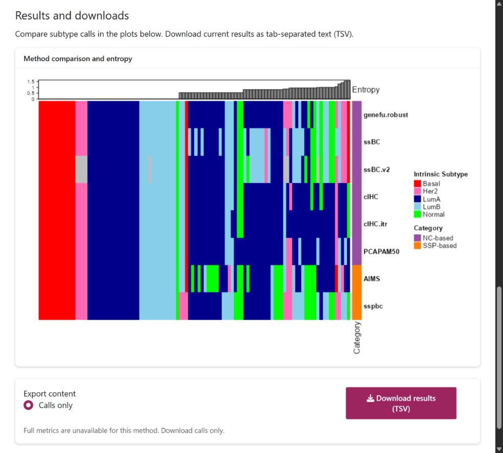

# BreastSubtypeR 

[](https://doi.org/10.1093/nargab/lqaf131)

[](https://bioconductor.org/checkResults/release/bioc-LATEST/BreastSubtypeR/ "Bioconductor release build status") [](https://www.gnu.org/licenses/gpl-3.0.html)

**BreastSubtypeR** is an R/Bioconductor package for intrinsic molecular
subtyping of breast cancer gene-expression data. It provides a common
workflow for published nearest-centroid (NC-based) and single-sample
predictor (SSP-based) methods, multi-method analysis and a local Shiny app.

**For research use.** Package outputs are not clinical assay results and
do not replace validated clinical diagnostics.

**Documentation scope:** this README describes GitHub `main`. Bioconductor
release and devel builds can have different APIs, example data and fixes.
Use the [channel-specific guides](#documentation-and-support) or your installed
function help when working with another revision.

[Publication](https://doi.org/10.1093/nargab/lqaf131) |
[Bioconductor package](https://bioconductor.org/packages/BreastSubtypeR/) |
[Release user guide](https://bioconductor.org/packages/release/bioc/vignettes/BreastSubtypeR/inst/doc/BreastSubtypeR.html)

[Installation](#installation) |
[Quick start](#quick-start) |
[Input coverage](#input-coverage) |
[Methods](#supported-methods) |
[Research ROR](#research-ror-interpretation) |
[Shiny](#local-shiny-application) |
[Support](#documentation-and-support)

## Installation

Install from the Bioconductor release compatible with your R installation,
following the [official installation guide](https://bioconductor.org/install/).
Check the [release package requirements](https://bioconductor.org/packages/release/bioc/html/BreastSubtypeR.html).
The build badge reports Bioconductor release status, not GitHub main.

```r
if (!requireNamespace("BiocManager", quietly = TRUE))
    install.packages("BiocManager", repos = "https://cloud.r-project.org")
BiocManager::install("BreastSubtypeR", update = FALSE, ask = FALSE)
```

<details>
<summary>GitHub main and Bioconductor devel (separate installations)</summary>

Start a fresh R session for each choice below. These examples use separate
libraries, leaving your usual user library out of the session. Use an R version
compatible with the chosen Bioconductor channel; see the
[devel setup guide](https://contributions.bioconductor.org/use-devel.html).
GitHub main currently requires R >= 4.5.0; its
[DESCRIPTION](https://github.com/JohanHartmanGroupBioteam/BreastSubtypeR/blob/main/DESCRIPTION)
records the source requirements.

**GitHub main:** install through BiocManager so that dependency resolution uses
the compatible Bioconductor repositories as well as CRAN. Its GitHub installer
also requires `remotes`.

```r
dev_lib <- path.expand("~/R/BreastSubtypeR-github")
dir.create(dev_lib, recursive = TRUE, showWarnings = FALSE)
.libPaths(c(dev_lib, .Library), include.site = FALSE)
if (!requireNamespace("BiocManager", quietly = TRUE))
    install.packages("BiocManager", repos = "https://cloud.r-project.org")
BiocManager::install("remotes", update = FALSE, ask = FALSE)
BiocManager::install("JohanHartmanGroupBioteam/BreastSubtypeR@main",
                     update = FALSE, ask = FALSE)
```

**Bioconductor devel:** use its own library and compatible R installation.
See the [Bioconductor devel build report](https://bioconductor.org/checkResults/devel/bioc-LATEST/BreastSubtypeR/).

```r
dev_lib <- path.expand("~/R/BreastSubtypeR-bioc-devel")
dir.create(dev_lib, recursive = TRUE, showWarnings = FALSE)
.libPaths(c(dev_lib, .Library), include.site = FALSE)
if (!requireNamespace("BiocManager", quietly = TRUE))
    install.packages("BiocManager", repos = "https://cloud.r-project.org")
BiocManager::install(version = "devel", update = FALSE, ask = FALSE)
BiocManager::install("BreastSubtypeR", update = FALSE, ask = FALSE)
```

In a later fresh session, repeat the `dev_lib` and `.libPaths()` setup to use
that library. Source and binary builds can differ within a channel. Matching
version numbers do not establish identical source or feature availability;
record the channel and source revision alongside
`packageVersion("BreastSubtypeR")` and `sessionInfo()`.

</details>

## Quick start

Run the public packaged OSLO2-EMIT0 example:

```r
library(BreastSubtypeR)
data("OSLO2EMIT0obj",
     package = "BreastSubtypeR")

mapped <- Mapping(
    OSLO2EMIT0obj$se_obj,
    RawCounts = FALSE,
    method = "max",
    impute = FALSE
)
result <- BS_Multi(
    data_input = mapped,
    methods = "AUTO",
    Subtype = FALSE,
    hasClinical = FALSE
)
head(result$res_subtypes)
```

`result$res_subtypes` has samples as rows, one column per executed method
and an `entropy` column. `Subtype = FALSE` requests the five-class summary;
`hasClinical = FALSE` omits clinical ROR-C/ROR-PC outputs, while NC methods
still return ROR-S/ROR-P. Entropy is raw Shannon disagreement in bits among
available calls, not calibrated confidence or accuracy; few available calls
can also give low entropy.

```r
Vis_Multi(result$res_subtypes)
```

**Preparing your own data:** `RawCounts = FALSE` expects log2-normalized
expression; raw RNA-seq counts require gene lengths. Follow `?Mapping` for
identifiers, annotation and receptor metadata. `Mapping()` preserves missing
measurements by default and resolves duplicate probes before optional
imputation. Missing raw counts are rejected; raw-derived expression is never
imputed.

For nonraw input, `impute = TRUE` fills supported holes in represented genes;
it does not add absent genes, and unsupported or unresolved targets cause an
error. This revised optional-imputation workflow differs from the original
publication, so incomplete-input estimates and predictions can change. See
`?Mapping` and the [input preparation details (pinned source guidance)](https://github.com/JohanHartmanGroupBioteam/BreastSubtypeR/blob/8519fedca7d06dca013ee52b3c128b17286e17f3/vignettes/BreastSubtypeR.Rmd#L143)
for donor selection, finite-value checks and output scales.

### Packaged examples

GitHub main includes expanded examples, retaining the public object names and
`se_obj`, `data_input` and `res` components. Other channels may still contain
the smaller historical inputs:

| Object | Input |
| --- | --- |
| `OSLO2EMIT0obj` | 569 genes x 102 samples; log2(protocol-adjusted FPKM + 1) |
| `TCGABRCAobj` | 5,350 genes x 100 samples; recount3 G026 base-pair coverage sums |

Expansion preserved all 356 original OSLO rows/values and all 5,000 original
TCGA rows/counts, annotations and sample metadata, appending 213 and 350 genes,
respectively.

Both examples map to 50 NC and 339 SSP genes using the default registries.
TCGA coverage sums have not been converted with `recount3::transform_counts()`.
Stored `data_input` and `res` reflect a pinned generation implementation,
not necessarily your installed revision. Input expansion and later
implementation corrections can affect recomputed results. Source hashes,
generation settings and historical comparisons are retained in the
[example provenance (GitHub)](https://github.com/JohanHartmanGroupBioteam/BreastSubtypeR/blob/main/data-raw/issue199/README.md);
`data-raw` is excluded from package builds.

The verified OSLO source is [Mendeley Data V4](https://doi.org/10.17632/yzxtxn4nmd.4).
SSPBC models were developed with unadjusted StringTie FPKM; equivalence with
protocol-adjusted OSLO expression has not been established. A complete source
gene union does not establish native SSP-ROR preparation or training-input
compatibility. Default Mapping remains unchanged and returns no `se_SSP_ROR`.
The opt-in `Mapping(include_ssp_ror = TRUE)` on GitHub main prepares a separate
`se_SSP_ROR`; stored `data_input$se_SSP` remains subtype-restricted and is not
a complete SSP-ROR input. See `?OSLO2EMIT0obj`, `?TCGABRCAobj` and the
[data attribution and limitations](https://github.com/JohanHartmanGroupBioteam/BreastSubtypeR/blob/main/inst/DATA-PROVENANCE.md).


### Input coverage

GitHub main provides `InputCoverage()` and the Shiny coverage table. For
another installed revision, check
`"InputCoverage" %in% getNamespaceExports("BreastSubtypeR")` before running
this additional example.

```r
InputCoverage(mapped)
```

Reports represented/absent genes and evaluable gene-pair rules for
NC-based (PAM50), AIMS, SSPBC (ssp.subtype) and SSPBC (ssp.pam50), using
bundled-model denominators and per-sample rule ranges. Inputs are already
processed and may include imputation. Coverage does not establish prediction
reliability, calibration feasibility or coverage of every ROR component;
it does not change method eligibility. See `?InputCoverage`.

## Supported methods

| Family | Method IDs |
| --- | --- |
| NC-based: PAM50 implementations | `parker.original`, `genefu.scale`, `genefu.robust` |
| NC-based: ER balancing | `cIHC`, `cIHC.itr`, `PCAPAM50` |
| NC-based: subgroup centering | `ssBC`, `ssBC.v2` |
| SSP-based | `AIMS`, `sspbc` |

`BS_Multi` also accepts at least two distinct methods, such as
`methods = c("AIMS", "sspbc")`. AUTO selects methods using implemented
cohort rules based on receptor annotations and subgroup sizes. It returns
per-method calls, not a consensus prediction. Selection does not establish
complete input adequacy or clinical validity. Method assumptions, exact
AUTO rules and threshold provenance remain in the
[pinned source guidance](https://github.com/JohanHartmanGroupBioteam/BreastSubtypeR/blob/8519fedca7d06dca013ee52b3c128b17286e17f3/vignettes/BreastSubtypeR.Rmd#L423).

AUTO ssBC/ssBC.v2 outputs cover the full input sample axis after calculation.
Unavailable results, including calibrated expression columns, are padded with
`NA`; no scores or expression values are invented. External PCA/clustering
consumers must exclude wholly unavailable columns and align annotations by ID.
See `?BS_Multi` for the output contract and plotting safeguards.

**PCA-PAM50 reproducibility:** the original PCAPAM50 1.0.4 reference's
locale-sensitive ordering is preserved. It affects cohort-calibration sample
selection, so subtype calls and numerical ROR outputs can differ with
`LC_COLLATE`; identical seeds alone do not guarantee cross-locale equality.
The package does not force a locale or normalize ID case. Record the effective
`Sys.getlocale("LC_COLLATE")`, exact sample IDs (including case) and order,
R version, `RNGkind()`, seed, package/source revision and dependency environment.
See `?BS_PCAPAM50` and the
[reproducibility guidance (pinned source guidance)](https://github.com/JohanHartmanGroupBioteam/BreastSubtypeR/blob/8519fedca7d06dca013ee52b3c128b17286e17f3/vignettes/BreastSubtypeR.Rmd#L328).

### Research ROR interpretation

The three outputs below have different interpretations. NC-based research
ROR uses Spearman centroid correlations; commercial Prosigna uses Pearson
correlations within its validated assay workflow. BreastSubtypeR scores,
groups and bins are not clinical Prosigna results.

**Original research ROR-S, ROR-P, ROR-C and ROR-PC:** on GitHub main, exact
equality at either original unscaled cutoff is assigned to `med` (#172):
low below, medium at or between, and high above the cutoffs. This is an
author-approved package convention supported by
[Nielsen et al. (2010)](https://doi.org/10.1158/1078-0432.CCR-10-1282) and
[Martin et al. (2016)](https://doi.org/10.1007/s10549-016-3725-z), not
historically proven equality semantics of the original distributed scripts.
Classification uses unrounded raw scores, not displayed or reverse-scaled
scores. The correction preserves numerical scores, cutoffs, nonboundary
groups and missing-value handling; older builds may retain numeric-text
boundary labels.

**Experimental 18-gene ROR-PC:** the existing
`ROR-PC (Subtype + Clinic + Prolif.Subtype)` and
`ROR-PC Group (Subtype + Clinic + Prolif.Subtype)` columns are separate from
the original 11-gene Parker ROR-PC. The package retains a calibrated,
unstandardized 18-gene mean, unlike the gene-wise standardization in the
published Lien calculation. Its prognostic performance and risk-category
thresholds have not been independently validated; it must not guide patient
care. Its separate NODE-dependent grouping retains inclusive upper bounds
for NODE = 0 or 1--3: equality at the lower boundary is **low**, unlike the
original ROR policy above. For an evaluated patient with valid binary
`TSIZE` (0 or 1), NODE >= 4 assigns **high** independently of the score.
Missing or invalid `TSIZE` leaves this group missing. Relevant NC calls emit
`bsr_experimental_ror_pc_warning`; `BS_Multi()` aggregates the notice once.
See `?BS_parker` and the [ROR guide (pinned source guidance)](https://github.com/JohanHartmanGroupBioteam/BreastSubtypeR/blob/8519fedca7d06dca013ee52b3c128b17286e17f3/vignettes/BreastSubtypeR.Rmd#L521)
for exact cutoffs, references and warning handling, including `options(warn = 2)`.

**Categorical SSP-ROR:** `BS_sspbc(..., ssp.name = "ssp.ror")` returns native
bin labels (`c005`, `c010`, ..., `c090`) and model posterior probabilities.
These are not continuous Parker-derived scores, NODE-adjusted risk groups
or recurrence probabilities. Complete gene coverage does not establish
training-scale equivalence or clinical validity. See `?BS_sspbc` and the
[SSP-ROR guide (pinned source guidance)](https://github.com/JohanHartmanGroupBioteam/BreastSubtypeR/blob/8519fedca7d06dca013ee52b3c128b17286e17f3/vignettes/BreastSubtypeR.Rmd#L641)
for preparation, sample alignment and the OSLO scale limitation.

## Local Shiny application

```r
BreastSubtypeR::iBreastSubtypeR()
```

The app runs locally in your R session. Install optional interface
dependencies if needed:

```r
install.packages(c("shiny", "bslib"))
```

1. **Data and preprocessing:** choose **Load example data...** or upload your
   expression, clinical and annotation tables, select the data type, then
   click **Preprocess & map**. **Input coverage** describes the current
   successful mapping.
2. **Analysis settings:** select a method and its settings, then click
   **Run subtyping**. Before successful preprocessing, AUTO displays
   **AUTO: awaiting preprocessing**. After mapping, it shows readiness
   counts or guidance for genuinely blocked annotations.
3. **Results and downloads:** inspect the current results and download
   tab-separated text (TSV), saved with a `.txt` extension. AUTO exports
   separate method calls and entropy;
   **Full metrics (incl. ROR)** is available for supported single NC methods.

For expression uploads, use comma-delimited `.csv` or tab-delimited text with
genes in rows and sample IDs in the header. Label the gene-ID column `probe`
when the layout is ambiguous, including when a named leading ID column
contains numeric IDs. An R export may omit the corner header if every data
row has exactly one more field than the header and the IDs corroborate that
layout. If only numeric-looking IDs overlap, all leading IDs must match
annotation. If the entire final sample is missing in an omitted-corner export,
label the ID column `probe` or write `NA` explicitly. Use a decimal point for measurements.
Keep every sample field on every row. Normalized expression accepts `NA`, `NaN`
and empty fields with their delimiters. Unnamed empty fields at the end of
the header and every data record are accepted as consistent export padding.
Place feature metadata such as symbols and descriptions in the annotation
table. Raw counts require a value in every measurement field.
The importer passes explicit `Inf` and `-Inf` through to preprocessing.
A numeric token that overflows R's double range (for example, `1e999`) raises
an input error that identifies the probe and sample.

Relevant selected Full metrics carry the experimental 18-gene ROR-PC notice
and display labels. Exports retain their existing column names and data,
with the interpretation recorded in the existing provenance comments.
Calls-only and AUTO exports do not acquire this score-specific notice.

Changing inputs or relevant settings clears stale predictions and downloads.
See the [Shiny guide (pinned source guidance)](https://github.com/JohanHartmanGroupBioteam/BreastSubtypeR/blob/8519fedca7d06dca013ee52b3c128b17286e17f3/vignettes/BreastSubtypeR.Rmd#L772)
for the preprocessing, recovery and export details.



*Public packaged OSLO2-EMIT0 example after preprocessing and five-class AUTO
subtyping: eight separate method calls and raw Shannon entropy.
[Open the screenshot at full size](man/figures/shiny-auto-oslo2-emit0.jpg).*

## Documentation and support

- [Release user guide](https://bioconductor.org/packages/release/bioc/vignettes/BreastSubtypeR/inst/doc/BreastSubtypeR.html)
- [Release reference manual](https://bioconductor.org/packages/release/bioc/manuals/BreastSubtypeR/man/BreastSubtypeR.pdf)
- [Bioconductor devel user guide](https://bioconductor.org/packages/devel/bioc/vignettes/BreastSubtypeR/inst/doc/BreastSubtypeR.html)
- [Bioconductor devel reference manual](https://bioconductor.org/packages/devel/bioc/manuals/BreastSubtypeR/man/BreastSubtypeR.pdf)
- [GitHub main vignette source](https://github.com/JohanHartmanGroupBioteam/BreastSubtypeR/blob/main/vignettes/BreastSubtypeR.Rmd) (R Markdown source, not the rendered Bioconductor guide)
- [Issues](https://github.com/JohanHartmanGroupBioteam/BreastSubtypeR/issues) and [Bioconductor Support](https://support.bioconductor.org/)

Use `browseVignettes("BreastSubtypeR")` and function help for your installed
version. For support, include a reproducible example, channel/source revision
and `sessionInfo()`.

## Citation and license

<a href="https://academic.oup.com/nargab/pages/editors-choice-articles"></a>

Yang Q, Hartman J, Sifakis EG (2025). BreastSubtypeR: a unified R/Bioconductor
package for intrinsic molecular subtyping in breast cancer research.
*NAR Genomics and Bioinformatics*, 7(4), lqaf131.
[doi:10.1093/nargab/lqaf131](https://doi.org/10.1093/nargab/lqaf131).

The article was selected as [Editor's Choice, 2025](https://academic.oup.com/nargab/pages/editors-choice-articles)
in *NAR Genomics and Bioinformatics*.

Use `citation("BreastSubtypeR")` for the installed package citation.

<details>
<summary>BibTeX</summary>

```bibtex
@article{Yang2025BreastSubtypeR,
  author = {Yang, Qiao and Hartman, Johan and Sifakis, Emmanouil G.},
  title = {{BreastSubtypeR}: a unified R/Bioconductor package for intrinsic molecular subtyping in breast cancer research},
  journal = {NAR Genomics and Bioinformatics},
  year = {2025},
  volume = {7},
  number = {4},
  pages = {lqaf131},
  doi = {10.1093/nargab/lqaf131},
  url = {https://doi.org/10.1093/nargab/lqaf131}
}
```

</details>

BreastSubtypeR is distributed under the
[GNU General Public License version 3](https://www.gnu.org/licenses/gpl-3.0.html).
