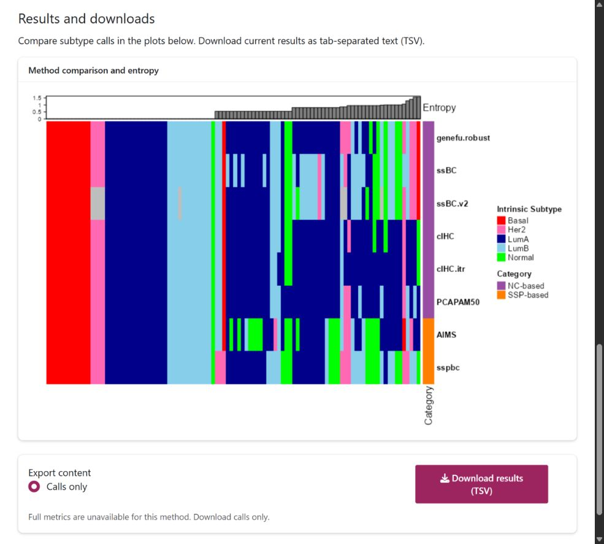

# BreastSubtypeR 

[](https://bioconductor.org/checkResults/release/bioc-LATEST/BreastSubtypeR/) [](https://bioconductor.org/checkResults/devel/bioc-LATEST/BreastSubtypeR/) [](https://www.gnu.org/licenses/gpl-3.0.html) [](https://doi.org/10.1093/nargab/lqaf131)

**BreastSubtypeR** is an R/Bioconductor package for intrinsic molecular
subtyping of breast cancer gene-expression data. It provides a common
workflow for published nearest-centroid (NC-based) and single-sample
predictor (SSP-based) methods, multi-method analysis and a local Shiny app.

**For research use.** Package outputs are not clinical assay results and
do not replace validated clinical diagnostics.

[Publication](https://doi.org/10.1093/nargab/lqaf131) |
[Bioconductor package](https://bioconductor.org/packages/BreastSubtypeR/) |
[Release user guide](https://bioconductor.org/packages/release/bioc/vignettes/BreastSubtypeR/inst/doc/BreastSubtypeR.html)

[Installation](#installation) |
[Quick start](#quick-start) |
[Input coverage](#input-coverage) |
[Methods](#supported-methods) |
[Shiny](#local-shiny-application) |
[Support](#documentation-and-support)

## Installation

Install from the Bioconductor release compatible with your R installation.
Consult the [package page](https://bioconductor.org/packages/release/bioc/html/BreastSubtypeR.html)
for the requirements of your selected channel.

```r
if (!requireNamespace("BiocManager", quietly = TRUE))
    install.packages("BiocManager")
BiocManager::install("BreastSubtypeR")
```

<details>
<summary>Development installations and feature availability</summary>

Use a separate library and compatible R version for
[Bioconductor devel](https://bioconductor.org/packages/devel/bioc/html/BreastSubtypeR.html):

```r
BiocManager::install(version = "devel")
BiocManager::install("BreastSubtypeR")
```

For GitHub development source, use a separate library configured for its
Bioconductor dependencies, then install GitHub main:

```r
if (!requireNamespace("remotes", quietly = TRUE))
    install.packages("remotes")
remotes::install_github("JohanHartmanGroupBioteam/BreastSubtypeR")
```

Distribution channels can differ; matching version numbers do not guarantee
matching source. Record the installation channel and source revision alongside
`packageVersion("BreastSubtypeR")` and `sessionInfo()`.

</details>

## Quick start

Run the public packaged OSLO2-EMIT0 example with a Bioconductor release or
GitHub installation:

```r
library(BreastSubtypeR)
data("OSLO2EMIT0obj", package = "BreastSubtypeR")

set.seed(1)
mapped <- Mapping(
    OSLO2EMIT0obj$se_obj,
    RawCounts = FALSE,
    method = "max",
    impute = TRUE
)
result <- BS_Multi(
    data_input = mapped,
    methods = "AUTO",
    Subtype = FALSE,
    hasClinical = FALSE
)
head(result$res_subtypes)
```

`Subtype = FALSE` requests the five-class summary; `hasClinical = FALSE`
disables clinical ROR outputs. Rows are samples and method columns contain
subtype calls. Entropy summarizes disagreement among available calls; it
is not a calibrated confidence or accuracy measure. Outputs can differ
between package versions.

```r
Vis_Multi(result$res_subtypes)
```

For your own data, follow `?Mapping` for identifiers, annotation and receptor
metadata. `RawCounts = FALSE` expects log2-normalized expression; raw RNA-seq
counts require gene lengths. See the
[release input preparation guide](https://bioconductor.org/packages/release/bioc/vignettes/BreastSubtypeR/inst/doc/BreastSubtypeR.html#quick-start).

### Input coverage

`InputCoverage()` and the Shiny coverage table are available in current GitHub
source. Availability in installed packages can differ between distribution
channels and source revisions. Matching package version numbers do not establish
feature availability. Check your installed version with
`"InputCoverage" %in% getNamespaceExports("BreastSubtypeR")` before running
this additional example.

```r
InputCoverage(mapped)
```

Reports represented/absent genes and evaluable gene-pair rules for
NC-based (PAM50), AIMS, SSPBC (ssp.subtype) and SSPBC (ssp.pam50), using
bundled-model denominators and per-sample rule ranges. Inputs are already
processed and may include imputation. Coverage does not establish prediction
reliability, calibration feasibility or coverage of every ROR component;
it does not change method eligibility. See `?InputCoverage`.

## Supported methods

| Family | Method IDs |
| --- | --- |
| NC-based: PAM50 implementations | `parker.original`, `genefu.scale`, `genefu.robust` |
| NC-based: ER balancing | `cIHC`, `cIHC.itr`, `PCAPAM50` |
| NC-based: subgroup centering | `ssBC`, `ssBC.v2` |
| SSP-based | `AIMS`, `sspbc` |

`BS_Multi` also accepts an explicit set, such as
`methods = c("AIMS", "sspbc")`. AUTO selects methods using implemented
cohort rules based on receptor annotations and subgroup sizes. It returns
per-method calls, not a consensus prediction. Selection does not establish
complete input adequacy or clinical validity. Method assumptions, exact
AUTO rules and threshold provenance remain in the
[development vignette source](vignettes/BreastSubtypeR.Rmd#quick-start).

### Research ROR interpretation

Research ROR outputs use Spearman centroid correlations. Commercial
Prosigna uses Pearson correlations within its validated assay workflow;
BreastSubtypeR scores and groups are not clinical Prosigna results.
Version 1.5.8 preserves the original Parker-derived grouping comparisons:
exact equality at an unscaled cutoff can return numeric text instead of a
valid risk category. This known defect is temporarily deferred for separate
scientific review, not endorsed as a valid category. The corrected
NODE-dependent additional ROR-PC grouping remains unchanged. See
[the ROR guide](vignettes/BreastSubtypeR.Rmd#four--versus-five-class-results-and-ror)
and `?BS_parker` for the exact cutoffs and methodological references.

## Local Shiny application

```r
BreastSubtypeR::iBreastSubtypeR()
```

The app runs locally in your R session. Install optional interface
dependencies if needed:

```r
install.packages(c("shiny", "bslib"))
```

The workflow below describes current GitHub main; Bioconductor builds can
have an older interface.

1. **Data and preprocessing:** choose **Load example data...** or upload your
   expression, clinical and annotation tables, select the data type, then
   click **Preprocess & map**. **Input coverage** describes the current
   successful mapping.
2. **Analysis settings:** select a method and its settings, then click
   **Run subtyping**. Before successful preprocessing, AUTO displays
   **AUTO: awaiting preprocessing**. After mapping, it shows readiness
   counts or guidance for genuinely blocked annotations.
3. **Results and downloads:** inspect the current results and download
   tab-separated text (TSV), saved with a `.txt` extension. AUTO exports
   separate method calls and entropy;
   **Full metrics** are available for supported single NC methods.

Changing inputs or relevant settings clears stale predictions and downloads.
See the [development Shiny guide source](vignettes/BreastSubtypeR.Rmd#shiny-app)
for the preprocessing, recovery and export details.



*Public packaged OSLO2-EMIT0 example after preprocessing and five-class AUTO
subtyping. Raw Shannon entropy measures disagreement among available method
calls, not calibrated confidence.*

## Documentation and support

- [Release user guide](https://bioconductor.org/packages/release/bioc/vignettes/BreastSubtypeR/inst/doc/BreastSubtypeR.html)
- [Release reference manual](https://bioconductor.org/packages/release/bioc/manuals/BreastSubtypeR/man/BreastSubtypeR.pdf)
- [Bioconductor devel user guide](https://bioconductor.org/packages/devel/bioc/vignettes/BreastSubtypeR/inst/doc/BreastSubtypeR.html)
- [Bioconductor devel reference manual](https://bioconductor.org/packages/devel/bioc/manuals/BreastSubtypeR/man/BreastSubtypeR.pdf)
- [GitHub development vignette source](vignettes/BreastSubtypeR.Rmd)
- [Issues](https://github.com/JohanHartmanGroupBioteam/BreastSubtypeR/issues) and [Bioconductor Support](https://support.bioconductor.org/)

Use `browseVignettes("BreastSubtypeR")` and function help for your installed
version. For support, include a reproducible example, channel/source revision
and `sessionInfo()`.

## Citation and license

<a href="https://academic.oup.com/nargab/pages/editors-choice-articles?login=false#:~:text=BreastSubtypeR"></a>

Yang Q, Hartman J, Sifakis EG (2025). BreastSubtypeR: a unified R/Bioconductor
package for intrinsic molecular subtyping in breast cancer research.
*NAR Genomics and Bioinformatics*, 7(4), lqaf131.
[doi:10.1093/nargab/lqaf131](https://doi.org/10.1093/nargab/lqaf131).

The article was selected as [Editor's Choice, 2025](https://academic.oup.com/nargab/pages/editors-choice-articles?login=false#:~:text=BreastSubtypeR)
in *NAR Genomics and Bioinformatics*.

Use `citation("BreastSubtypeR")` for the installed package citation.

<details>
<summary>BibTeX</summary>

```bibtex
@article{Yang2025BreastSubtypeR,
  author = {Yang, Qiao and Hartman, Johan and Sifakis, Emmanouil G.},
  title = {{BreastSubtypeR}: a unified R/Bioconductor package for intrinsic molecular subtyping in breast cancer research},
  journal = {NAR Genomics and Bioinformatics},
  year = {2025},
  volume = {7},
  number = {4},
  pages = {lqaf131},
  doi = {10.1093/nargab/lqaf131},
  url = {https://doi.org/10.1093/nargab/lqaf131}
}
```

</details>

BreastSubtypeR is distributed under the
[GNU General Public License version 3](https://www.gnu.org/licenses/gpl-3.0.html).
